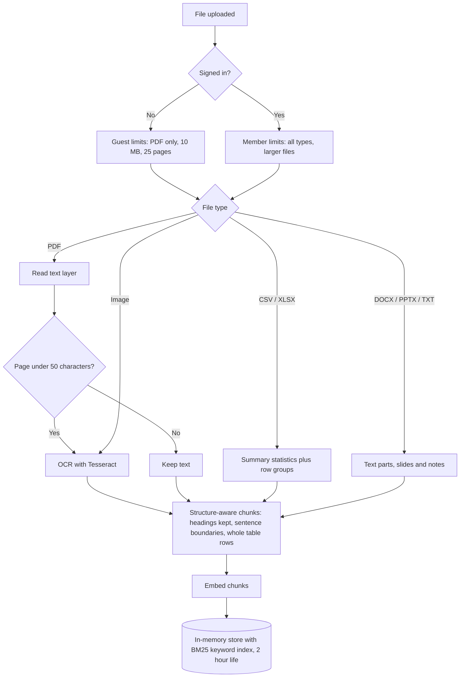
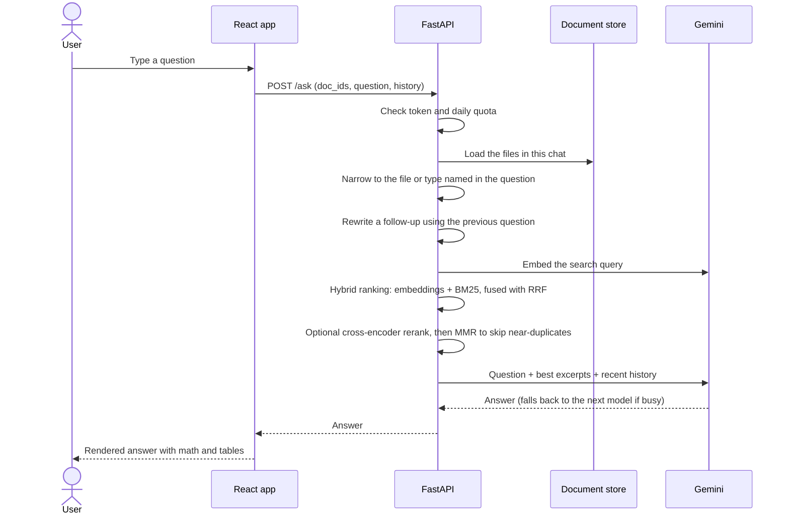
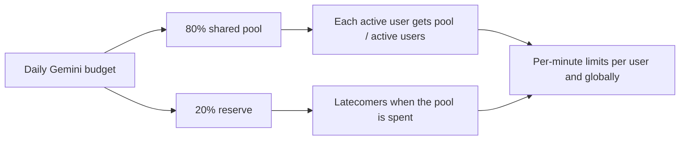

<p align="center">
  
</p>

<h1 align="center">Pagehound</h1>

<p align="center">
  Upload a document, ask questions, get answers. A retrieval-augmented chatbot for PDFs, scans, spreadsheets, Word files and slides.
</p>

<p align="center">
  <a href="https://pagehound.vercel.app"><b>Live demo</b></a> ·
  <a href="docs/ARCHITECTURE.md">Architecture</a> ·
  <a href="docs/PROGRESS.md">Progress log</a>
</p>

<p align="center">
  
  
  
  
  
</p>

> The backend runs on a free server that sleeps when idle, so the first request after a quiet period can take about a minute.

## Screenshots

<table align="center">
  <tr>
    <td align="center" width="50%">
      <br />
      <b>Home</b><br />
      <sub>Landing screen with a single prompt box. Click + to upload a file, then ask anything about it.</sub>
    </td>
    <td align="center" width="50%">
      <br />
      <b>Answers from your document</b><br />
      <sub>Structured replies with headings, a boxed formula, a table and highlighted terms, plus follow-up questions.</sub>
    </td>
  </tr>
  <tr>
    <td align="center" width="50%">
      <br />
      <b>Sign in with Google</b><br />
      <sub>Signing in unlocks more file types (CSV, Excel, Word, PowerPoint, images) and saves your chat history.</sub>
    </td>
    <td align="center" width="50%">
      <br />
      <b>Mobile</b><br />
      <sub>The same chat on a phone: the layout, table and formula adapt to the narrow screen.</sub>
    </td>
  </tr>
</table>

_The chat screenshots use a sample document and answer to show the layout._

## Features

- **Many file types:** PDF, PNG/JPG/WEBP/BMP/TIFF (OCR), CSV/TSV/XLSX, DOCX, PPTX, TXT, MD.
- **Scanned pages:** pages with no text layer are detected and read with Tesseract OCR.
- **Retrieval-augmented answers:** files are split into chunks, embedded, and only the most relevant chunks are sent to Gemini.
- **Measured retrieval quality:** hybrid search (BM25 + embeddings with Reciprocal Rank Fusion), follow-up query rewriting, structure-aware chunking, MMR diversity and an optional cross-encoder reranker, checked against a labelled evaluation set with Recall@k and MRR.
- **Live thinking indicator:** a shimmering "Thinking" label with animated dots and a status line that moves from searching to writing, and explains a slow cold start.
- **Multi-file chats:** questions search every file in the chat, or only the file or file type you mention ("in the pdf", "in the csv"). Guests and signed-in users can add files to the same chat.
- **Readable answers:** formulas are drawn in their own boxes with KaTeX, column names and key terms show as highlighted chips, and tables render as tables.
- **Chats that behave like other chat apps:** every chat has its own address (`/c/<id>`), refreshing keeps your place, a new tab starts fresh, back and forward work, and a question interrupted by a refresh is asked again automatically.
- **Google sign-in:** chat history is saved per user in Firestore with owner-only security rules. A chat started as a guest moves into your account when you sign in.
- **Fair free-tier sharing:** a quota manager divides a daily Gemini budget between active users. Busy Gemini models are retried, then the next model is tried.
- **Prompt-injection guardrails:** attempts to read the system prompt or override its rules are refused before the model is called, untrusted text is fenced off in the prompt, replies that echo the instructions are blocked, and answers never load images or unsafe links.
- **Responsive dark UI:** animated logo intro, aurora background, solid title bar, works from phone to desktop.

## How it works


### Upload pipeline



### Asking a question



### Quota sharing



## Retrieval quality

The answer can only be as good as the excerpts sent to Gemini, so retrieval is tuned and measured, not guessed.

| Technique | What it fixes | Where |
|---|---|---|
| **Structure-aware chunking** | Chunks follow headings and sentence boundaries, each chunk keeps its section heading, and table rows are never cut in half. | `app/chunking.py` |
| **Hybrid search** | Embeddings (dense retrieval) understand meaning but miss exact codes like `ORD-1047` or `E4`; **BM25** keyword search catches them. The two rankings are merged with **Reciprocal Rank Fusion (RRF)**, and chunks containing an exact identifier from the question (letters and digits mixed) are boosted to the top, because RRF alone can bury a single strong keyword match. | `app/lexical.py`, `app/retrieval.py` |
| **Query decomposition** | A message with several questions ("What is X? Who owns Y? When is Z?") is split into separate searches, each with its own share of excerpts, so no question is crowded out. In a stand-in test, messages of 8 questions went from 84% to 97% of answers retrieved. | `app/query.py`, `app/retrieval.py` |
| **Query rewriting** | A follow-up such as "And for the secondary one?" is searched together with the previous question, so it finds the right section. | `app/query.py` |
| **MMR (Maximal Marginal Relevance)** | Stops repeated boilerplate from filling several of the excerpt slots. | `app/retrieval.py` |
| **Cross-encoder reranking** | A second model reads the question and each candidate together and re-orders the top 20. Measured: MRR 0.82 → 0.90, but about 1.5 s per question on a laptop CPU, so it is off on the free server (`RERANK=1` to enable). | `app/rerank.py` |

### Evaluation

`backend/eval/` holds a small **golden dataset**: four sample documents (handbook, product manual, research notes, orders table) and 46 labelled questions covering paraphrased, exact-code and follow-up questions. The script adds one technique at a time and reports **Recall@1/3/8** (how often the right chunk is retrieved) and **MRR** (how high it ranks).

```powershell
cd backend
python eval/run.py --save            # uses the embedding backend from .env
python eval/run.py --rerank --save   # also measures the reranker
```

Results (bge-small embeddings, each row adds one technique):

| Setup | Recall@1 | Recall@8 | MRR | Exact codes R@3 | Follow-ups R@3 |
|---|---|---|---|---|---|
| Baseline: fixed chunks, embeddings only | 0.50 | 0.83 | 0.64 | 0.64 | 0.57 |
| + structure-aware chunking | 0.63 | 0.85 | 0.72 | 0.73 | 0.43 |
| + hybrid search with exact-match boost | 0.67 | 0.96 | 0.77 | 1.00 | 0.71 |
| + follow-up query rewriting | 0.72 | 0.98 | 0.81 | 1.00 | 1.00 |
| **+ MMR (live site)** | **0.72** | **0.98** | **0.82** | **1.00** | **1.00** |
| + cross-encoder reranker (optional) | 0.85 | 0.98 | 0.90 | 1.00 | 1.00 |

The live configuration finds the right excerpt for 98% of questions (up from 83%) at about 2 ms of ranking per question. The reranker lifts Recall@1 to 0.85 but costs about 1.5 s per question on a laptop CPU, so it stays off on the free server. Full table: `backend/eval/results.md`. Every switch can be turned off in `.env` (`HYBRID`, `MMR`, `REWRITE_FOLLOW_UPS`, `STRUCTURED_CHUNKS`, `RERANK`).

## Security and prompt injection

Everything a user controls (the question, the chat history and the text inside uploaded files) is treated as untrusted. The defences are layered so that no single check has to be perfect:

| Layer | Where | What it does |
|---|---|---|
| Input guard | `backend/app/guard.py` | Normalizes the question (Unicode, hidden characters, spacing) and refuses prompt-extraction and rule-override attempts with a fixed reply. The model is not called and no quota is used. |
| Prompt fencing | `backend/app/llm.py` | Excerpts, history and the question sit inside `<document_excerpts>`, `<conversation>` and `<question>` blocks. Look-alike tags in untrusted text are removed so a file cannot close a block early. |
| History filter | `backend/app/guard.py` | History comes from the browser, so user turns that look like injection attempts are dropped before they reach the model. |
| System prompt rules | `backend/app/llm.py` | Instructions inside documents are treated as content, never commands; the instructions are confidential; unrelated tasks are declined. |
| Output guard | `backend/app/guard.py` | A random canary in the system prompt, plus a check for passages copied from it, blocks any reply that leaks the instructions. Text that really comes from the uploaded file is not counted. |
| Safe rendering | `frontend/src/Answer.tsx` | Answers never load images (a common data-exfiltration trick), raw HTML is skipped, and only `http(s)` links render, opening in a new tab with `noopener noreferrer nofollow`. |

| Web hardening | `frontend/vercel.json`, `backend/app/main.py` | Security headers on the site and API: `nosniff`, `X-Frame-Options: DENY` (no clickjacking), referrer and permissions policies, HSTS, and `Cache-Control: no-store` so answers are never cached. |
| Debug paths | `backend/app/config.py` | The test-only identity header works only when `ENV=dev`; the default is production, so a missing setting can never open it. |
| Dependencies | `npm audit`, `pip-audit` | Both report no known vulnerabilities; patched versions of nested `katex` and `@grpc/grpc-js` are forced with npm `overrides`. |

Other protections: Firebase ID tokens are verified on the server, documents are only readable by their owner, Firestore rules are owner-only, and uploads have size, page, row and pixel limits. Pattern-based guards can be bypassed by new phrasings, which is why the prompt rules and the output check sit behind them.

## Privacy

- Uploaded files are processed in memory and deleted within 2 hours; they are never written to disk or a database.
- Chat history is stored only for signed-in users, in Firestore, readable by its owner only.
- Answers are generated with Google's free Gemini API tier. Under Google's terms, content sent to the free tier may be used to improve Google's products and read by human reviewers, so a one-line notice under the input tells users not to upload sensitive documents. A paid Gemini tier would remove this.
- Logs record errors and blocked attacks, never questions or file contents.

## Run locally

Backend (Windows PowerShell):

```powershell
cd backend
python -m venv .venv
.venv\Scripts\Activate.ps1
pip install -r requirements.txt
copy .env.example .env
uvicorn app.main:app --reload --port 8000
```

Set `GEMINI_API_KEY` (a free key from Google AI Studio) and `FIREBASE_PROJECT_ID` in `backend/.env`. Install [Tesseract](https://github.com/tesseract-ocr/tesseract) for OCR.

Frontend:

```powershell
cd frontend
npm install
copy .env.example .env
npm run dev
```

Fill the `VITE_FIREBASE_*` values from your Firebase web app, and add the frontend address to `ALLOWED_ORIGINS` in the backend `.env`. Firestore rules are in [`firestore.rules`](firestore.rules).

## Configuration

| Variable | Where | Purpose |
|---|---|---|
| `GEMINI_API_KEY` | backend | Gemini access |
| `GEMINI_MODELS` | backend | Models to try, in order |
| `EMBED_BACKEND` | backend | `local` (fastembed) or `gemini` |
| `ALLOWED_ORIGINS` | backend | Frontend addresses allowed by CORS |
| `FIREBASE_PROJECT_ID` | backend | Verifies sign-in tokens |
| `DAILY_BUDGET`, `RESERVE_FRACTION` | backend | Quota sharing |
| `VITE_API_URL` | frontend | Backend address |
| `VITE_FIREBASE_*` | frontend | Firebase web config |

## Deployment

- **Backend:** Docker on Render's free web service (`backend/Dockerfile` installs Tesseract). Uses Gemini embeddings to stay within free memory.
- **Frontend:** Vercel, root directory `frontend`.
- **Auth and history:** Firebase, with the Vercel domain added to authorized domains.

## Tests

```powershell
cd backend
pip install -r requirements-dev.txt
python -m pytest -q
```

`tests/test_guard.py` covers known injection phrasings, normal questions that must still pass, tag spoofing, history filtering and leak detection.

## Tech stack

Python, FastAPI, PyMuPDF, Tesseract, fastembed, NumPy, Google Gemini, React, TypeScript, Vite, Firebase Auth and Firestore, KaTeX.

## Limitations

- Uploaded documents live in server memory for 2 hours, and quota counters reset when the server restarts.
- Handwriting OCR is weak; printed scans work well.
- Free Gemini tiers can be busy, so the backend tries several models in turn.

## Author

**Vigesh** — designed and built Pagehound.

GitHub: [@Vigesh-VS](https://github.com/Vigesh-VS)

## License

MIT. See [LICENSE](LICENSE).
