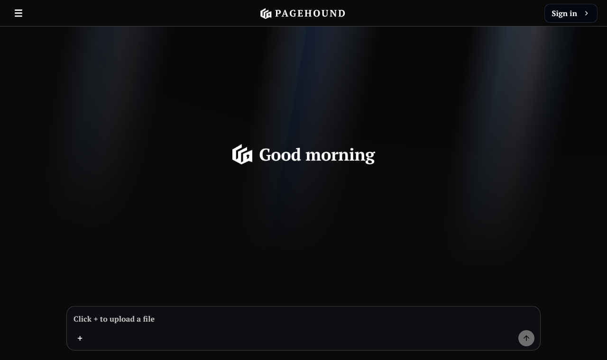
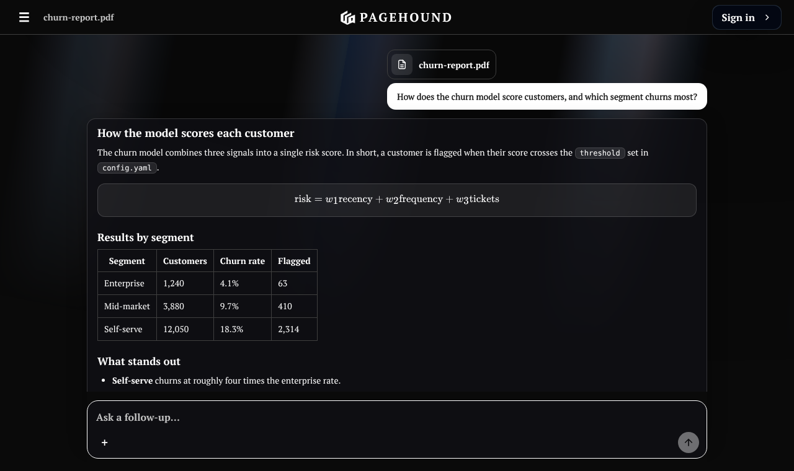
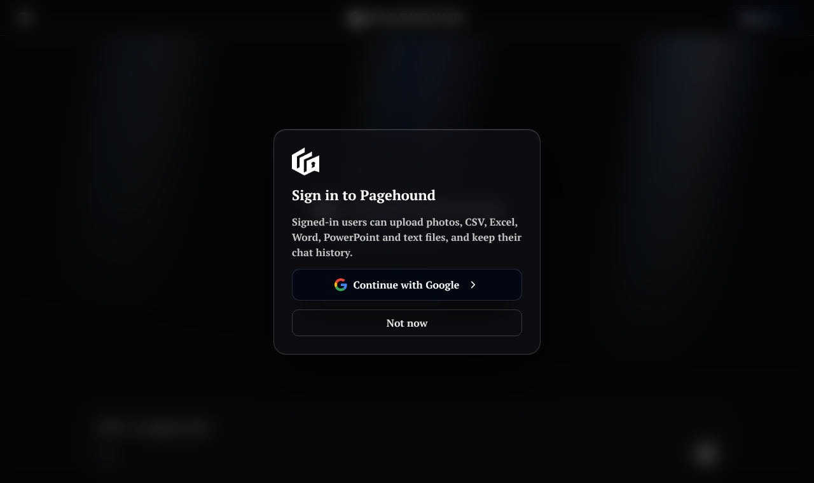
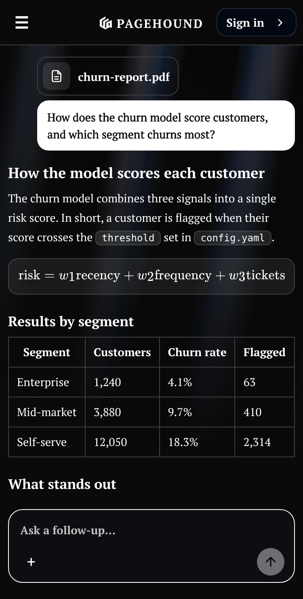
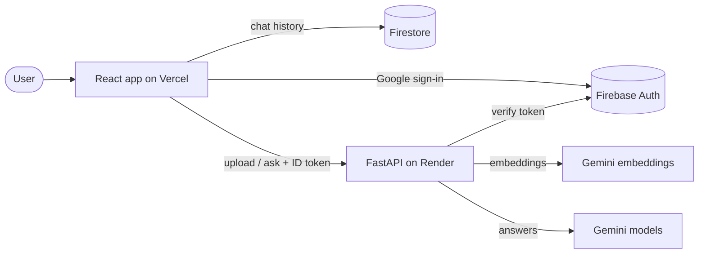
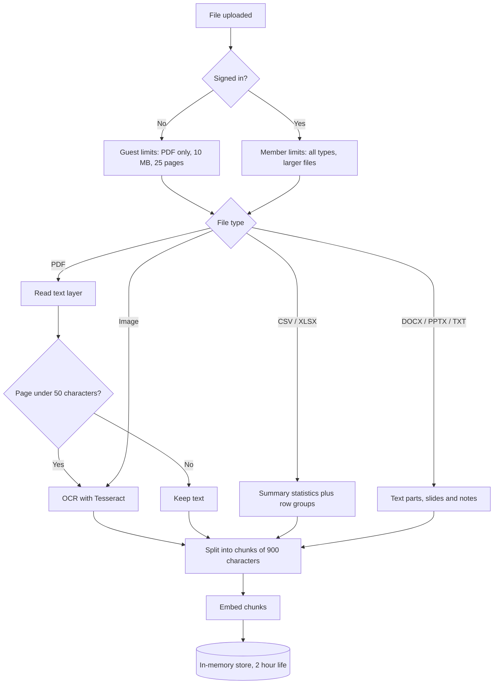
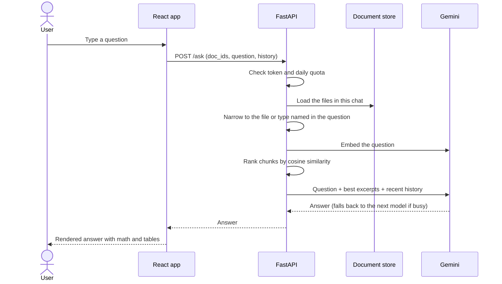
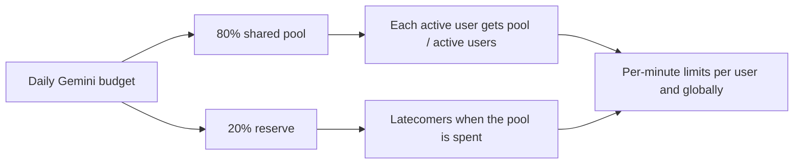

<p align="center">
  
</p>

<h1 align="center">Pagehound</h1>

<p align="center">
  Upload a document, ask questions, get answers. A retrieval-augmented chatbot for PDFs, scans, spreadsheets, Word files and slides.
</p>

<p align="center">
  <a href="https://pagehound.vercel.app"><b>Live demo</b></a> ·
  <a href="docs/ARCHITECTURE.md">Architecture</a> ·
  <a href="docs/PROGRESS.md">Progress log</a>
</p>

<p align="center">
  
  
  
  
  
</p>

> The backend runs on a free server that sleeps when idle, so the first request after a quiet period can take about a minute.

## Screenshots

<table align="center">
  <tr>
    <td align="center" width="50%">
      <br />
      <b>Home</b><br />
      <sub>Landing screen with a single prompt box. Click + to upload a file, then ask anything about it.</sub>
    </td>
    <td align="center" width="50%">
      <br />
      <b>Answers from your document</b><br />
      <sub>Structured replies with headings, a boxed formula, a table and highlighted terms, plus follow-up questions.</sub>
    </td>
  </tr>
  <tr>
    <td align="center" width="50%">
      <br />
      <b>Sign in with Google</b><br />
      <sub>Signing in unlocks more file types (CSV, Excel, Word, PowerPoint, images) and saves your chat history.</sub>
    </td>
    <td align="center" width="50%">
      <br />
      <b>Mobile</b><br />
      <sub>The same chat on a phone: the layout, table and formula adapt to the narrow screen.</sub>
    </td>
  </tr>
</table>

_The chat screenshots use a sample document and answer to show the layout._

## Features

- **Many file types:** PDF, PNG/JPG/WEBP/BMP/TIFF (OCR), CSV/TSV/XLSX, DOCX, PPTX, TXT, MD.
- **Scanned pages:** pages with no text layer are detected and read with Tesseract OCR.
- **Retrieval-augmented answers:** files are split into chunks, embedded, and only the most relevant chunks are sent to Gemini.
- **Multi-file chats:** questions search every file in the chat, or only the file or file type you mention ("in the pdf", "in the csv"). Guests and signed-in users can add files to the same chat.
- **Readable answers:** formulas are drawn in their own boxes with KaTeX, column names and key terms show as highlighted chips, and tables render as tables.
- **Chats that behave like other chat apps:** every chat has its own address (`/c/<id>`), refreshing keeps your place, a new tab starts fresh, back and forward work, and a question interrupted by a refresh is asked again automatically.
- **Google sign-in:** chat history is saved per user in Firestore with owner-only security rules. A chat started as a guest moves into your account when you sign in.
- **Fair free-tier sharing:** a quota manager divides a daily Gemini budget between active users. Busy Gemini models are retried, then the next model is tried.
- **Responsive dark UI:** animated logo intro, aurora background, solid title bar, works from phone to desktop.

## How it works



### Upload pipeline



### Asking a question



### Quota sharing



## Run locally

Backend (Windows PowerShell):

```powershell
cd backend
python -m venv .venv
.venv\Scripts\Activate.ps1
pip install -r requirements.txt
copy .env.example .env
uvicorn app.main:app --reload --port 8000
```

Set `GEMINI_API_KEY` (a free key from Google AI Studio) and `FIREBASE_PROJECT_ID` in `backend/.env`. Install [Tesseract](https://github.com/tesseract-ocr/tesseract) for OCR.

Frontend:

```powershell
cd frontend
npm install
copy .env.example .env
npm run dev
```

Fill the `VITE_FIREBASE_*` values from your Firebase web app, and add the frontend address to `ALLOWED_ORIGINS` in the backend `.env`. Firestore rules are in [`firestore.rules`](firestore.rules).

## Configuration

| Variable | Where | Purpose |
|---|---|---|
| `GEMINI_API_KEY` | backend | Gemini access |
| `GEMINI_MODELS` | backend | Models to try, in order |
| `EMBED_BACKEND` | backend | `local` (fastembed) or `gemini` |
| `ALLOWED_ORIGINS` | backend | Frontend addresses allowed by CORS |
| `FIREBASE_PROJECT_ID` | backend | Verifies sign-in tokens |
| `DAILY_BUDGET`, `RESERVE_FRACTION` | backend | Quota sharing |
| `VITE_API_URL` | frontend | Backend address |
| `VITE_FIREBASE_*` | frontend | Firebase web config |

## Deployment

- **Backend:** Docker on Render's free web service (`backend/Dockerfile` installs Tesseract). Uses Gemini embeddings to stay within free memory.
- **Frontend:** Vercel, root directory `frontend`.
- **Auth and history:** Firebase, with the Vercel domain added to authorized domains.

## Tests

```powershell
cd backend
pip install -r requirements-dev.txt
python -m pytest -q
```

## Tech stack

Python, FastAPI, PyMuPDF, Tesseract, fastembed, NumPy, Google Gemini, React, TypeScript, Vite, Firebase Auth and Firestore, KaTeX.

## Limitations

- Uploaded documents live in server memory for 2 hours, and quota counters reset when the server restarts.
- Handwriting OCR is weak; printed scans work well.
- Free Gemini tiers can be busy, so the backend tries several models in turn.

## Author

**Vigesh** — designed and built Pagehound.

GitHub: [@Vigesh-VS](https://github.com/Vigesh-VS)

## License

MIT. See [LICENSE](LICENSE).
